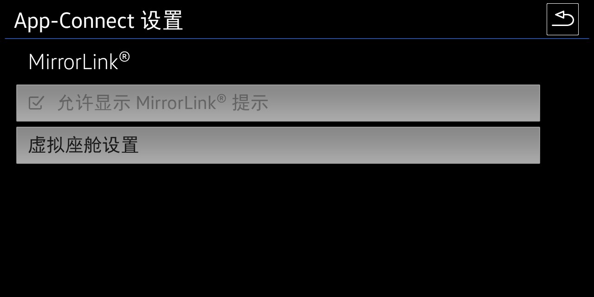
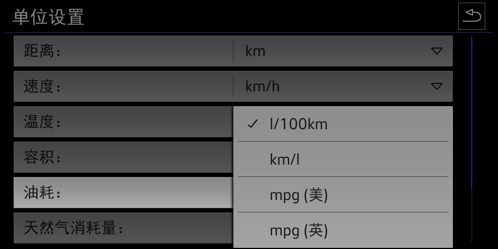
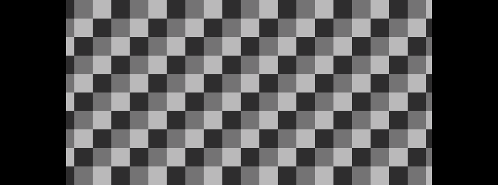
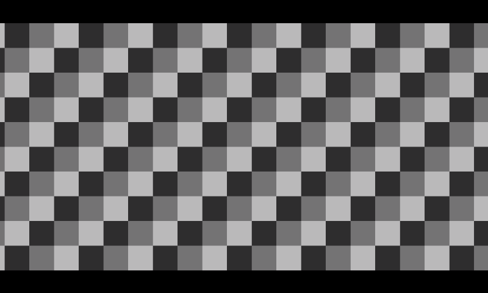
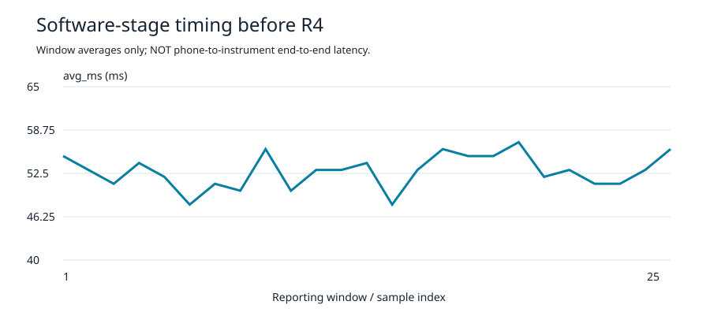
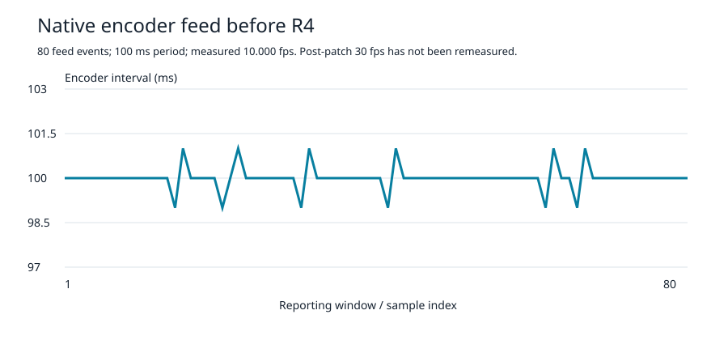

# Virtual Cockpit development progress

[中文](README.md) · [Version 2.0 release](https://github.com/omonob/MHI2-Carplay-Maps/releases/tag/toolbox-plaintext-v2.0.0) · [Measurement data](evidence/mirror-performance-summary.json)

As of 28 October 2026, the public work covers native menus, persistent independent switches, separate AID 10.5 and AID 12.3 mirroring outputs, canvas zoom and navigation cards. Wireless CarPlay currently exposes a test switch and read interface, not a phone-connectable wireless receiver. This update adds development evidence without replacing the released 2.0 installer.

CarPlay navigation-information mapping, music metadata, album-art modules and their test images are excluded. Device identities, credentials, keys, full unit logs and licensed SDK material are also excluded.

## Native menus

The final design appends an independent Virtual Cockpit settings entry under App-Connect. MirrorLink remains intact. Renaming/reusing MirrorLink was rejected because the original page could appear during its transition animation.

This is an unchanged native-HMI emulator capture from menu development on MU1102, not vehicle acceptance of the complete 2.0 package.

| Selector | Public implementation | Boundary |
| --- | --- | --- |
| VC Maps | CarPlay Maps or original maps; saved state | AA map engine not bundled |
| VC Mirroring | CP mirroring; maps take priority; conflicts disabled | AA and CarLife engines not bundled |
| Wireless CarPlay | Saved test switch/read interface; default off | No actual wireless-service actions |
| Navigation card | AID 10.5: Center/Left/Right/Off; AID 12.3: On/Off | Final AID 12.3 compact parameters remain experimental |

Selectors use native continuous scrolling, not page buttons. The MU1102 reference skin uses 1139 px row width, 94 px model height and 91 px row pitch. Model height is not the visible grey-background height. These are skin-specific reference values, not universal dimensions for another brand or resolution.

This unchanged native-HMI emulator capture documents the dropdown background, separators and spacing used as the reference.

CRC checks, staged commits and a previous valid copy preserve preferences across restarts. Damaged primary files can recover from a valid backup without silently resetting the user. There are 31 translated locale tables; rendering depends on the firmware fonts. Menu APIs were compiled separately for all three firmware profiles, with host tests for persistence, recovery, conflicts and separate-process reload.

Source: [native menu lifecycle](../../../src/vc-menu/src/org/omonob/cpmap/ui/IndependentMenuViewBridge.java), [linked preferences](../../../src/vc-menu/src/org/omonob/cpmap/ui/ProjectionSettings.java), [card preferences](../../../src/vc-menu/src/org/omonob/cpmap/ui/CardPositionSettings.java).

## Mirroring and canvas zoom

AID 10.5 always outputs 1010×376; AID 12.3 always outputs 800×480. Scaling, letterboxing or cropping the content never changes the instrument's encoded output dimensions. In CP mirroring, the original VW keys or Škoda roller control the canvas; in map mode they still control the phone map.

These unchanged native-renderer captures use a synthetic 1264×640 checkerboard source at 4 fps, with both canvases at 100%. No phone was connected. They validate dimensions, canvas behavior and cleanup, not real-phone performance.

The AID 10.5 card core retains the on-unit golden baseline; Waze has a known layout issue. The AID 12.3 experimental safe area is `(220,65,360,348)`, with bottom 413. The final tuple still needs vehicle confirmation, and the shared safe area can affect map framing.

Source: [renderer](../../../src/vc-runtime/mirror/carplay_mirror_receiver.c), [fixed-output contract](../../../src/vc-runtime/mirror/cpvc_output_contract.h), [wheel routing](../../../src/vc-menu/src/org/omonob/cpmap/ui/ClusterCommandRouter.java), [card declarations](../../../src/card-core/source/navigation_card_scene.h).

## Frame cadence and timing

The 27 October 2026 MU1102 / AID 10.5 bench records distinguish rendering from the native encoder feed. Periodic size queries were removed first, but the native 10 fps cadence remained. A later patch translates the original request to 30 fps only in AID 10.5 CP mirroring.

| Measurement location | Before the rate-request patch | Interpretation |
| --- | --- | --- |
| Decoded capture | 8 intervals, 25.70–28.69 fps | Capture speed, not cluster display FPS |
| GLES render counter | Last 25 roughly 1 s windows: 28–30 frames; mean 28.84 | Counts per reporting window, not exact physical-panel FPS |
| Capture-to-render software stage | Window averages 48–57 ms; arithmetic mean 52.8 ms | Excludes phone input, native encoding, MOST and the instrument display |
| Native encoder feed | 80 events; probe elapsed 8002 ms; measured 10.000 fps | Encoder feed cadence, not panel frame counting |
| After the 30 fps request patch | Deployment, reboot readback and user hot-switch feedback passed | No matching numeric encoder-FPS or end-to-end-latency remeasurement yet |

`avg_ms` runs from the decoded surface's queue timestamp to completion of EGL swap. The 52.8 ms figure is not phone-input-to-instrument latency, a per-frame value or P95. The 30 fps value is the patched request target, not a confirmed stable measured output. The map stream's 40/60 fps declarations are a separate path.

The exports contain numeric fields only, with process IDs, absolute uptime, network addresses and complete logs removed: [capture intervals](evidence/decoded-capture-intervals.csv), [renderer windows](evidence/renderer-windows.csv), [encoder feed](evidence/encoder-feed-before-r4.csv). Original-log hashes are retained in the [summary](evidence/mirror-performance-summary.json). The [export script](../../../tools/Summarize-MirrorEvidence.ps1) supports the same bounded log format.

## Wireless CarPlay

The public menu switch defaults off and saves an independent `wireless-carplay.state` with a previous valid copy. Java writes and native C reads use the same format. Unreadable/corrupt state without a valid backup is treated as off. The 48-check host suite and separate-JVM reload passed. Changing the switch does not start or stop a wireless service.

Source: [Java writer](../../../src/vc-menu/src/org/omonob/cpmap/ui/WirelessCarPlaySettings.java), [C reader](../../../src/vc-runtime/runtime/cpvc_wireless_settings.h), [minimal read-only example](../../../examples/wireless-state-reader.c).

A separate MU1102 radio investigation recorded the following on 25 August 2026; an 11 October 2026 RAM-only session also read back 2.4 GHz / 40 MHz driver state. These are wireless-link observations, not acceptance of a complete wireless CarPlay session.

| Layer | Recorded result | Scope |
| --- | --- | --- |
| PHY negotiation | 150 Mbps at 2.4 GHz / 40 MHz | Not application goodput |
| Memory-to-memory TCP | Two 180 s terminal-to-unit runs: 57.1 and 54.7 Mbps | Specific channel, environment and method |
| 5 GHz experiment | No usable/connectable BSS on that test unit | Not a claim about every MHI2 hardware variant |
| Wireless CarPlay service | Not bundled in public 2.0 | A saved switch or adequate bandwidth is not a connected session |

Discovery, session establishment, phone association, media routing and disconnect recovery still need a repeatable integrated acceptance test. Licensed communications SDK code, MFi authentication material, keys and complete OEM libraries are not published or bundled.

## Next validation

- Remeasure encoder cadence and final output after the 30 fps request patch under the same conditions.
- Measure phone-input-to-instrument latency with synchronized clocks or high-speed video.
- Confirm the final AID 12.3 card tuple and the complete public package on the vehicle.
- Integrate a wireless service before claiming first connection, reconnection or actual service control. Until then, the status remains interface available, service unreleased.

Screenshots are unchanged offline-test captures; charts are generated from sanitized numbers. Real map photos are omitted to avoid exposing personal locations. See [image provenance and hashes](evidence/image-provenance.json).
